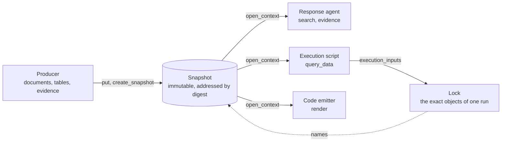

<p align="center">
  <picture>
    <source media="(prefers-color-scheme: dark)" srcset="docs/brand/wordmark-dark.svg">
    
  </picture>
</p>

<p align="center"><b>A knowledge base store for agents.</b><br>
Every agent, script and code emitter reads the same snapshot.</p>

---

Your manual says the pump seal is replaced every 500 hours. Your chat agent quotes that from a text chunk. Your maintenance script reads it from a CSV someone exported last spring. Your code generator reads a schema from a third place. When the three disagree, nobody can say which inputs produced which answer.

Aavanam puts the document, the table and the evidence that links them into one immutable snapshot. The agent, the script and the emitter all open that snapshot. Each run can lock the exact objects it read, so you can name its inputs later. The store keeps your rule files and emitter templates as opaque bytes; it never runs them.

*Aavanam* (ஆவணம்) is Tamil for "document" or "record".

## Try it

You need Python 3.14 or later. There are no other dependencies: the store uses the SQLite module that ships with Python.

```bash
git clone https://github.com/mohanraj00/aavanam && cd aavanam
PYTHONPATH=src python3
```

Store a short manual and a service table in one snapshot, then read it from two consumers:

```python
import base64, hashlib, json
from aavanam import Store

store = Store()  # in memory; Store('pump.sqlite') keeps a file

def put(kind, text=None, media_type='text/plain', **fields):
    desc, data = {'descriptor_profile': 'aavanam/base/v1', 'kind': kind, **fields}, {}
    if text is not None:
        raw = text.encode()
        digest = 'sha256:' + hashlib.sha256(raw).hexdigest()
        desc['payload'] = {'digest': digest, 'media_type': media_type, 'size': len(raw)}
        data = {digest: base64.b64encode(raw).decode()}
    return store.call('put', {'descriptors': [json.dumps(desc)], 'payloads': data})['items'][0]['ref']

# The producer: a document, a table, and the evidence that links them.
manual = put('source', '# Pump P-1\nReplace the seal every 500 hours.\n', 'text/markdown')
reading = put('reading', 'Pump P-1. Replace the seal every 500 hours.', source=manual,
              producer='example/reader', coverage_profile='example/coverage/v1')
schema = put('schema', '{"fields": ["part", "interval_h"]}', 'application/json', schema_profile='example/schema/v1')
table = put('data-resource', json.dumps({'columns': ['part', 'interval_h'], 'key': ['part'],
                                         'rows': [['seal', 500], ['bearing', 2000]]}),
            'application/json', data_profile='aavanam/table/v1', schema=schema)
evidence = put('evidence', subject=table, supports=reading, origin='example/editor')
bindings = put('binding-set', bindings={'intervals': table})
unit = put('knowledge-unit', binding_set=bindings, relation_sets=[put('relation-set', members=[evidence])])
snap = store.call('create_snapshot', {'collection': 'pump-manual', 'units': [unit]})
print('snapshot', snap['status'])
snap = snap['items'][0]['ref']

# Consumer 1, a response agent: search the text, then find what backs the table.
agent = store.call('open_context', {'roots': [snap]})['context']
hit = store.call('search', {'context': agent, 'query': 'seal'})['items'][0]
print('agent found', hit['kind'], hit['ref'] == reading)
support = store.call('evidence', {'context': agent, 'subject': table})['items']
print('agent cites', [s['relation'] for s in support])

# Consumer 2, an execution script: read typed rows, then lock its inputs.
script = store.call('open_context', {'roots': [snap]})['context']
rows = store.call('query_data', {'context': script, 'resources': [table], 'where': {'part': 'seal'}})
print('script reads seal interval_h =', rows['items'][0]['rows'][0]['interval_h'])
lock = store.call('execution_inputs', {'context': script, 'binding_set': bindings,
                                       'consumer': 'example/service-script',
                                       'completeness': 'aavanam/closure-only/v1'})
print('lock', lock['status'], len(lock['items']), 'objects')
```

Output:

```text
snapshot ok
agent found reading True
agent cites ['support']
script reads seal interval_h = 500
lock ok 3 objects
```

The lock covers the binding set, the table and its schema. The test suite runs this block and compares the output, so it stays true ([tests/test_readme.py](tests/test_readme.py)).

## How it fits



A changed byte is a new object, so a new table means a new snapshot. A context that is open on the old snapshot keeps reading the old one.

## What it is not

- Not a rule engine or a policy engine. Applications own their rules; Aavanam stores them as opaque bytes.
- Not access control. A capability says what a store can do, not who can call it.
- Not a proof of completeness. A lock is complete over the references it declares, and its result says so.
- Not a vector database. Semantic search is reserved and not built.
- Not the product runtime. The code in `src/aavanam/` is a reference implementation that shows the spec can be built and that each conformance vector is exact.

## Where it stands

Version 0.1.0 is the first public marker. All 16 contract documents are drafts. The next work is lifecycle and discovery, then integrations with producers and consumers. [docs/STATUS.md](docs/STATUS.md) gives the status.

| Fact | Value |
|---|---|
| Contract clauses | 248, in 16 documents under `docs/contracts/` |
| Conformance vectors | 400. The reference implementation passes all of them |
| Null implementation | Passes 1 vector and fails 399. The runner exits with 1 |
| End-to-end acceptance | 9 vectors. Four consumers on two neutral collections, through an export, a device import and a read on the device, plus 1 composed context |
| Reference implementation | Python over SQLite. The standard library only |

Each refusal vector has a positive pair, so an implementation that refuses all calls fails. No expected value comes from an implementation run. Each vector states its provenance: the spec, a defect reproduced in a pre-build prototype, or a planted fault.

## 0.1 compatibility

Within the 0.1 series, the reference store preserves the documented `aavanam/base/v1` minor version 3 descriptor meanings, canonical reference digests, `aavanam-bundle/v1` transfer format and the outcomes of the 0.1.0 conformance vectors. A later 0.1 version can add compatible behavior and vectors.

The Python reference API, the conformance runner interface, the SQLite layout and the producer adapter interface can change. Use a versioned bundle to transfer a snapshot between store versions. The producer seam test is pending, and reserved operations return their specified unsupported status. The source version identifies the draft specification, conformance vectors and reference store together.

See [the changelog](CHANGELOG.md) for the contents of 0.1.0.

## Run the checks

```bash
make check
```

The `check` target runs the spec check, the conformance tests, the tests in `tests/`, the store runner, the null runner and the project check. The null runner must fail with exit 1. The CI runs these checks on Ubuntu and macOS for each PR.

Start at [SPEC.md](SPEC.md) for the specification and [CONTRIBUTING.md](CONTRIBUTING.md) for the workflow. The brand files are in [docs/brand/](docs/brand/README.md).

Licence: Apache-2.0.
