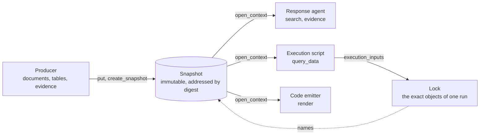

<p align="center">
  <picture>
    <source media="(prefers-color-scheme: dark)" srcset="docs/brand/wordmark-dark.svg">
    
  </picture>
</p>

<p align="center"><b>A knowledge base store for agents.</b><br>
Every agent, script and code emitter reads the same snapshot.</p>

---

Your manual says the pump seal is replaced every 500 hours. Your chat agent quotes that from a text chunk. Your maintenance script reads it from a CSV someone exported last spring. Your code generator reads a schema from a third place. When the three disagree, nobody can say which inputs produced which answer.

Aavanam puts the document, the table and the evidence that links them into one immutable snapshot. The agent, the script and the emitter all open that snapshot. Each run can lock the exact objects it read, so you can name its inputs later. The store keeps your rule files and emitter templates as opaque bytes; it never runs them.

*Aavanam* (ஆவணம்) is Tamil for "document" or "record".

## Try it

You need Python 3.14 or later, because the CI tests only Python 3.14. There are no other dependencies: the store uses the SQLite module that ships with Python. This README describes release 0.6.0.

```bash
git clone https://github.com/mohanraj00/aavanam && cd aavanam
PYTHONPATH=src python3
```

Store a short manual and a service table in one snapshot, then read it from two consumers:

```python
import base64, hashlib, json
from aavanam import Store

store = Store()  # in memory; Store('pump.sqlite') keeps a file

def put(kind, text=None, media_type='text/plain', **fields):
    desc, data = {'descriptor_profile': 'aavanam/base/v1', 'kind': kind, **fields}, {}
    if text is not None:
        raw = text.encode()
        digest = 'sha256:' + hashlib.sha256(raw).hexdigest()
        desc['payload'] = {'digest': digest, 'media_type': media_type, 'size': len(raw)}
        data = {digest: base64.b64encode(raw).decode()}
    return store.call('put', {'descriptors': [json.dumps(desc)], 'payloads': data})['items'][0]['ref']

# The producer: a document, a table, and the evidence that links them.
manual = put('source', '# Pump P-1\nReplace the seal every 500 hours.\n', 'text/markdown')
reading = put('reading', 'Pump P-1. Replace the seal every 500 hours.', source=manual,
              producer='example/reader', coverage_profile='example/coverage/v1')
schema = put('schema', '{"fields": ["part", "interval_h"]}', 'application/json', schema_profile='example/schema/v1')
table = put('data-resource', json.dumps({'columns': ['part', 'interval_h'], 'key': ['part'],
                                         'rows': [['seal', 500], ['bearing', 2000]]}),
            'application/json', data_profile='aavanam/table/v1', schema=schema)
evidence = put('evidence', subject=table, supports=reading, origin='example/editor')
bindings = put('binding-set', bindings={'intervals': table})
unit = put('knowledge-unit', binding_set=bindings, relation_sets=[put('relation-set', members=[evidence])])
snap = store.call('create_snapshot', {'collection': 'pump-manual', 'units': [unit]})
print('snapshot', snap['status'])
snap = snap['items'][0]['ref']

# Consumer 1, a response agent: search the text, quote it, then find what backs the table.
agent = store.call('open_context', {'roots': [snap]})['context']
hit = store.call('search', {'context': agent, 'query': 'seal'})['items'][0]
print('agent found', hit['kind'], hit['ref'] == reading)
cite = {'selector_profile': 'aavanam/bytes/v1', 'start': 10, 'end': 43}
quote = store.call('read', {'context': agent, 'ref': hit['ref'], 'selector': cite})['items'][0]
print('agent quotes', repr(base64.b64decode(quote['data']).decode()),
      'from bytes', quote['selector']['start'], 'to', quote['selector']['end'], 'of the', quote['kind'])
support = store.call('evidence', {'context': agent, 'subject': table})['items']
print('agent cites', [s['relation'] for s in support])

# Consumer 2, an execution script: read typed rows, then lock its inputs.
script = store.call('open_context', {'roots': [snap]})['context']
rows = store.call('query_data', {'context': script, 'resources': [table], 'where': {'part': 'seal'}})
print('script reads seal interval_h =', rows['items'][0]['rows'][0]['interval_h'])
lock = store.call('execution_inputs', {'context': script, 'binding_set': bindings,
                                       'consumer': 'example/service-script',
                                       'completeness': 'aavanam/closure-only/v1'})
print('lock', lock['status'], len(lock['items']), 'objects')
```

Output:

```text
snapshot ok
agent found reading True
agent quotes 'Replace the seal every 500 hours.' from bytes 10 to 43 of the reading
agent cites ['support']
script reads seal interval_h = 500
lock ok 3 objects
```

The lock covers the binding set, the table and its schema. The test suite runs this block and compares the output, so it stays true ([tests/test_readme.py](tests/test_readme.py)). Each call has its own page in [docs/operations/](docs/operations/README.md), with an example that continues this one.

## How it fits



A changed byte is a new object, so a new table means a new snapshot. A context that is open on the old snapshot keeps reading the old one.

## What it is not

- Not a rule engine or a policy engine. Applications own their rules; Aavanam stores them as opaque bytes.
- Not access control. A capability says what a store can do, not who can call it.
- Not a proof of completeness. A lock is complete over the references it declares, and its result says so.
- Not a vector database. Semantic search is reserved and not built.
- Not the product runtime. The code in `src/aavanam/` is a reference implementation that shows the spec can be built and that each conformance vector is exact.

## Next docs

- [docs/operations/](docs/operations/README.md): one page for each operation, with an example that runs.
- [SPEC.md](SPEC.md): the specification and its 24 contract documents.
- [examples/](examples/README.md): complete examples, from a clean install of the package.
- [docs/STATUS.md](docs/STATUS.md): the status and the vector result of each implementation.
- [CHANGELOG.md](CHANGELOG.md): the contents and the known limits of each release.

## Where it stands

Version 0.6.0 is the current version. In version 0.6.0, all 24 contract documents are normative.

| Fact | Value |
|---|---|
| Contract clauses | 513, in 24 documents under `docs/contracts/` |
| Conformance vectors | 824. The reference implementation passes all of them |
| Null implementation | Passes 1 vector and fails 823. The runner exits with 1 |
| End-to-end acceptance | 9 vectors. Four consumers on two neutral collections, through an export, a device import and a read on the device, plus 1 composed context |
| Reference implementation | Python over SQLite. The standard library only |

Each refusal vector has a positive pair, so an implementation that refuses all calls fails. No expected value comes from an implementation run. Each vector states its provenance: the spec, a defect reproduced in a pre-build prototype, or a planted fault.

## Which implementation to use

The repository has three implementations of the spec. Each implementation passes all the conformance vectors. The vectors, not the code, say what each one does.

| Implementation | Use it to | Storage | Code |
|---|---|---|---|
| Reference | Learn the spec, write a producer, run the examples and test an adapter. | SQLite, the Python standard library only | `src/` |
| Backend service | Run a shared store that many consumers read over a network. | PostgreSQL 17, with a storage in memory for tests only | `backend/` |
| Device store | Read an exported bundle on a device, with no server and with the text search. | Two SQLite files, with an FTS5 index | `reference/` |

- The reference is the first choice to start. It has no dependency outside Python, and the examples in this file use it.
- The backend service is a Go service. A client reads with `POST /v1/op/<operation>` on the read binding `aavanam-read/v1` (document 22). A write does not go through the read listener.
- The device store has the layout `aavanam/device-sqlite/v1` (document 21). A device imports a bundle with `import`, and a second `import` adds only the new content.
- The backend and the device store share one Go core. The Python reference is separate code, so the vectors compare two independent implementations.
- Access control is out of scope. The read listener binds to the loopback address by default. A deployment puts access control in front of it.
- This repository has no measured size or time numbers for the backend or the device store. Do not use it as evidence of speed.

[docs/STATUS.md](docs/STATUS.md) gives the vector result of each implementation and the command that runs it.

## Install and run an example

The CI builds a wheel and a source archive from a clean copy of each commit. Then it installs the wheel in a clean environment and runs each example in [examples/](examples/README.md) from that environment. [examples/README.md](examples/README.md) gives the steps to do the same from a clean checkout.

The package is not on a package index. A publication to an index needs a separate approval of the maintainer.

## What the 0.x series can change

Aavanam has no stable release. Until version 1.0, a minor version (for example 0.1 to 0.2) can change these:

- The Python API of the reference implementation, and the request and result forms of `Store.call`.
- The SQLite layout of a store file. A new version can refuse a store file of an older version.
- The conformance runner interface and the producer adapter interface.
- A clause of a `draft` topic, and the conformance vectors. A changed vector keeps its reason in the history.

A patch version (for example 0.1.0 to 0.1.1) keeps the guarantees in the next section. Use a versioned bundle to transfer a snapshot between store versions.

## 0.6 compatibility

Each 0.6.x release keeps these:

- The normative clauses of contract documents 01 to 24. A change of the meaning of a normative clause withdraws the clause, adds a new clause and names the affected vectors (SPEC.md, "Clause IDs").
- The descriptor meanings of `aavanam/base/v1` at minor version 14, and of the profiles of documents 21 to 24.
- The canonical reference digests.
- The transfer formats `aavanam-bundle/v1` and `aavanam-bundle-raw/v1`.
- The outcomes of the 0.6.0 conformance vectors.

A later 0.6 release can add compatible clauses, kinds, fields, reasons and vectors. Such an addition increments the minor version of its profile.

The topics in the `draft` state: none.

Each topic of documents 01 to 24 is normative. If a later 0.6 release keeps a new topic in the `draft` state, this list names it, and a clause of that topic can change in place.

The Python reference API, the conformance runner interface, the SQLite layout and the producer adapter interface can change. Use a versioned bundle to transfer a snapshot between store versions. Reserved operations return their specified unsupported status. The source version identifies the specification, the conformance vectors and the reference store together.

## Run the checks

```bash
make check
```

The `check` target runs the spec check, the conformance tests, the tests in `tests/`, the store runner, the null runner and the project check. The null runner must fail with exit 1. The CI runs these checks on Ubuntu and macOS for each PR.

Start at [SPEC.md](SPEC.md) for the specification and [CONTRIBUTING.md](CONTRIBUTING.md) for the workflow. The brand files are in [docs/brand/](docs/brand/README.md).

Licence: Apache-2.0.
